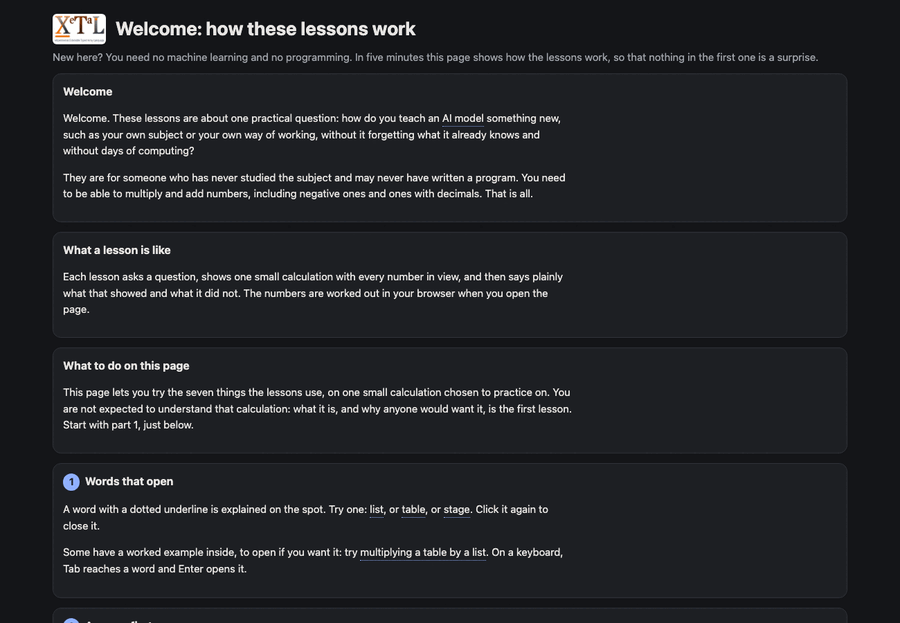
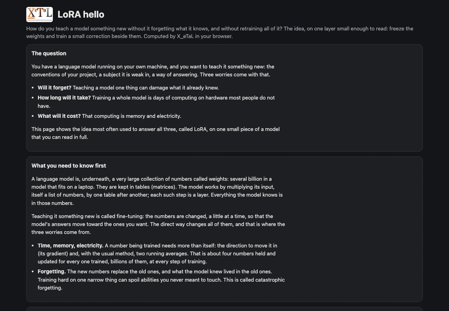
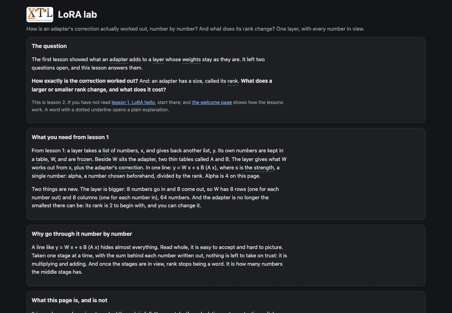
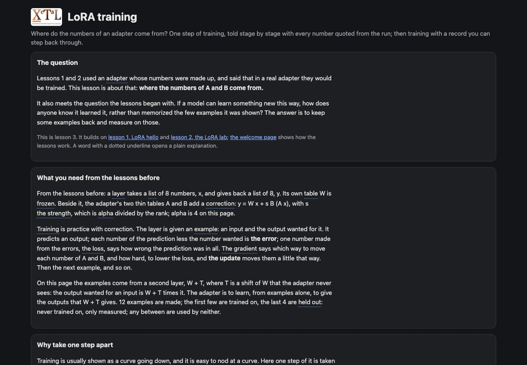
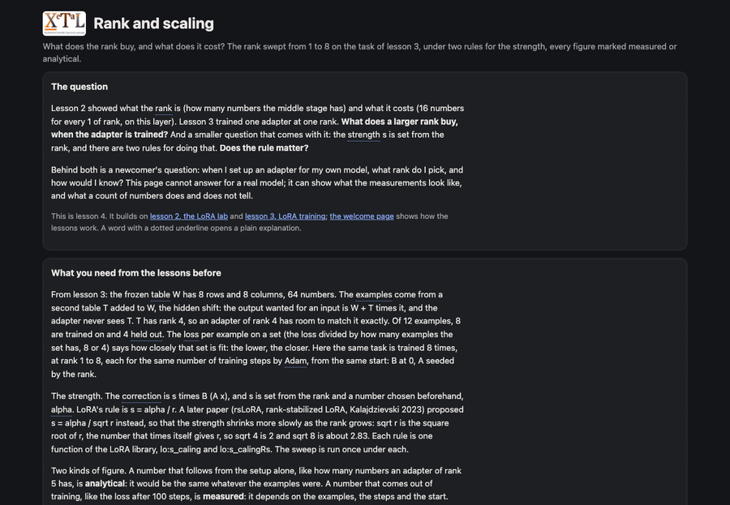
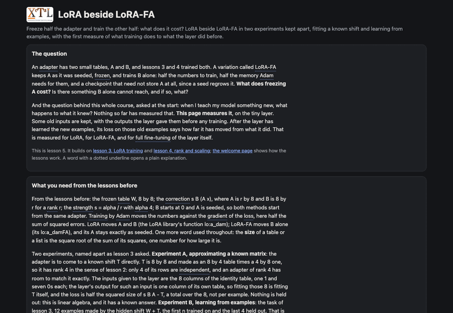
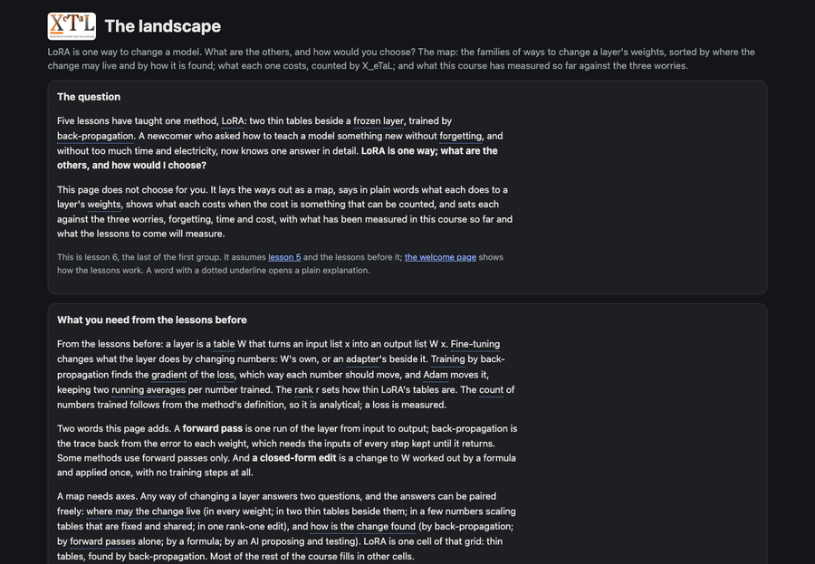

<h1>
  
  
</h1>

Interactive experiments in model adaptation, fine-tuning and direct
weight editing, in [X_eTaL](https://github.com/softwarewrighter/X_eTaL),
the eXperimental Extensible Typed Array Language: lessons a beginner
can follow, with every number computed by a short array program you
can read.

## Summary

Fine-tuning changes what a trained model does by changing some of its
numbers. This repository teaches how, from the first idea (a weight, a
prediction, an error) to low-rank adapters (LoRA and its variations),
the alternatives to them (among them learning without
back-propagation), direct edits of a model's weights and an AI doing
the editing, and it measures the methods against each other on the
same small tasks.

It starts from the
[LoRA explorer](https://softwarewrighter.github.io/X_eTaL-ML/lora-explorer/)
of [X_eTaL-ML](https://github.com/softwarewrighter/X_eTaL-ML), which
shows the mathematics of one adapted layer. The explorer stays as it
is; here the same libraries are put behind a guided laboratory for
someone who knows arithmetic and has never trained a network.

Every lesson follows one arc:

> a question and your prediction -> one small experiment -> what
> changed, in plain words and measured numbers -> the mathematics and
> the X_eTaL code, as deep as you want to go.

What a lesson promises:

- **Three depths, one computation.** Beginner (guided, plain language),
  Explorer (every control) and Advanced (equations, gradients, source)
  show the same run; switching never resets it.
- **Everything is explained.** Each symbol and control has a
  definition, a short explanation, a worked example and a lesson, by
  mouse, keyboard or touch.
- **Step through it.** The forward pass and a training step play,
  pause and step both ways; any cell shows its own arithmetic with its
  numbers.
- **Changes are explained, not just redrawn.** Move the rank and the
  page says what that did, from what it measured, including when it
  did not help: on an 8 x 8 layer, rank 4 trains as many numbers as
  full fine-tuning.
- **Every number is real.** The values, shapes and loss figures on a
  page come from the X_eTaL program it shows; nothing is recomputed in
  the browser's own code.

## Why an array language for fine-tuning

A LoRA layer is `y = W x + s B (A x)`: two matrix products, a scale
and a sum. Its gradients are two outer products. A rank-one model edit
is one outer product and one solve. In X_eTaL each is one short, typed
expression over whole arrays, so a lesson can show the method itself,
with every intermediate array and its shape, instead of a framework
call:

```
lo:f_orward := { (W, A, B, s) x -> (W '+ '* i_nner x) + s * B '+ '* i_nner A '+ '* i_nner x }
```

Read right to left: `A x` first (r numbers), then `B` of that, scaled,
added to the frozen layer's output. The 8 x 8 matrix `B A` is never
made.

## The X_eTaL repositories

| Repo | What it is |
| ---- | ---------- |
| [X_eTaL](https://github.com/softwarewrighter/X_eTaL) | the language, interpreter, REPL, editor, notebook and browser playground |
| [X_eTaL-demos](https://github.com/softwarewrighter/X_eTaL-demos) | visual array and scientific computing demos |
| [X_eTaL-ML](https://github.com/softwarewrighter/X_eTaL-ML) | machine-learning demos and libraries |
| **X_eTaL-fine-tuning** (this repo) | lessons and experiments in fine-tuning, adapters and weight editing |
| [X_eTaL-games](https://github.com/softwarewrighter/X_eTaL-games) | interactive games and puzzles |
| [X_eTaL-libraries](https://github.com/softwarewrighter/X_eTaL-libraries) | reusable function and macro libraries |
| [X_eTaL-extensions](https://github.com/softwarewrighter/X_eTaL-extensions) | native Rust extensions and the extension ABI |
| [X_eTaL-gpu](https://github.com/softwarewrighter/X_eTaL-gpu) | X_eTaL programs on GPUs, old ones included (OpenCL) |
| [X_eTaL-fpga](https://github.com/hardwarewrighter/X_eTaL-fpga) | X_eTaL programs as hardware (FPGA circuits) |

## The road

Three stages, in this order ([`docs/plan.md`](docs/plan.md)):

| Stage | Methods | The question |
| ----- | ------- | ------------ |
| 1. LoRA | a frozen layer and a low-rank adapter, its training, rank and scale, LoRA-FA | how can a model learn something new while its weights stay as they are? |
| 1. LoRA variations | QLoRA, DoRA, VeRA and others; adapters in a mixture of experts | what does each variation change, and what does it buy or cost? |
| 1. Shared subspaces | the idea under several variations: a fixed basis reused across tasks, small coefficients for each; which directions to keep; tasks learned in sequence | where may a change live, and when does sharing that place between tasks help or hurt? |
| 2. Alternatives | weight-space methods that use no back-propagation (zeroth-order optimization and evolution strategies: MeZO, DART-ES, AGZO, StructZO, Dust), beside back-propagation itself; then the other alternatives briefly | can a model learn from forward passes alone, at what cost, and when is that the better choice? |
| 3. Bleeding edge | an edit found and checked without training (a direction removed from a layer), closed-form edits of a layer (ROME, MEMIT, AlphaEdit) under a gate, an AI doing the editing | can a model be changed without training at all, can that be trusted, and can a model do it to a model? |
| Later: applied | a coding model taught a team's engineering standards, measured by an executable grader, on real open-weight models | does any of this make a real model better at a real job, and how is that proved? |

Every method is held to the same account: what was learned, what was
lost, and what it cost, on the same task, beside a baseline that
changes no weight.

## Demos

Live: [the catalog](https://softwarewrighter.github.io/X_eTaL-fine-tuning/).

| Demo | What you see | The line that does it |
| ---- | ------------ | --------------------- |
| [Welcome](demos/welcome/README.md) ([live](https://softwarewrighter.github.io/X_eTaL-fine-tuning/welcome/)) | new here? Five minutes on how these lessons work, nothing to know beforehand: words that open a plain explanation, a guess first, a calculation you step through and watch (its numbers appearing stage by stage), pictures of the numbers, a sum written out, a change put into words, three depths | `y := @ flow:p_ipe< ...`: the calculation as four stages in a row, whose recorded values the page replays |
| [LoRA hello](demos/lora-hello/README.md) ([live](https://softwarewrighter.github.io/X_eTaL-fine-tuning/lora-hello/)) | start here, with no machine learning and no programming assumed: how do you teach a model something new without it forgetting, and without retraining all of it? The question and the background, every term opening a plain explanation; one frozen layer of 16 numbers and an adapter of 8, all shown; one calculation worked in five steps as you change the input or the strength; the cost on a real layer (0.78% of its numbers at rank 16); what that showed and what it did not. The code is folded into asides, each library function explained from its own source and linked to the cross-reference | `y := (W, A, B, s) lo:f_orward x`: the layer and its adapter are one bundle, taken apart by the library |
| [LoRA lab](demos/lora-lab/README.md) ([live](https://softwarewrighter.github.io/X_eTaL-fine-tuning/lora-lab/)) | lesson 2: how is the correction worked out, number by number, and what does the rank change and cost? One layer of 64 frozen numbers and an adapter of rank 1 to 8, every number in view: the calculation taken a stage at a time (squeeze, spread, add), any square's sum written out from printed products, the three formulas with each letter to pick, the rank slider with what changed said from the two runs' numbers, and the honest limit: nothing is trained, so no rank is shown better | `y := @ flow:p_ipe< ...`: the layer as four stages, each an equation, whose recorded values and marked formulas the page draws |
| [LoRA training](demos/lora-training/README.md) ([live](https://softwarewrighter.github.io/X_eTaL-fine-tuning/lora-training/)) | lesson 3: where do the numbers of A and B come from? One step of training told in six stages with every number quoted from the run (the prediction, the error, the gradients, the update, W's difference exactly 0 and the library's step agreeing); then training by Adam with a record to step back through, X_eTaL's chart of the loss on the examples trained on beside the loss on 4 held out, and three experiments as files of settings: a first run, too large a learning rate, too few examples at too large a rank; what each record shows is said from its numbers | `\|> "dB[i,k] \| 8 r" e:e_q< "sum m:=0..n-1 \| s * g[i,m] * h[k,m]" $dB`: a gradient is one more stage of the pipeline, an equation like the forward ones |
| [Rank and scaling](demos/rank-and-scaling/README.md) ([live](https://softwarewrighter.github.io/X_eTaL-fine-tuning/rank-and-scaling/)) | lesson 4: what does the rank buy, and what does it cost? The rank swept from 1 to 8 on lesson 3's task under LoRA's s = alpha / r and rsLoRA's s = alpha / sqrt r, 16 training runs in under a second: the numbers trained (analytical), the two losses after the same steps and the size of s B A (measured), every figure marked; X_eTaL's charts; alpha and the steps as sliders that rerun the sweep; a rank to read about, and an account of the whole table written from its numbers, including where training left the held-out loss above its untrained value; never a rank called better | `alpha lo:s_calingRs k`: the two rules differ in one number of the adapter's bundle, the strength |
| [LoRA beside LoRA-FA](demos/lora-vs-fa/README.md) ([live](https://softwarewrighter.github.io/X_eTaL-fine-tuning/lora-vs-fa/)) | lesson 5: freeze half the adapter and train the other half: what does it cost? Two experiments kept apart. Fitting a known shift T: LoRA and LoRA-FA from the same start, against the lowest loss possible at the rank (from T's singular values, analytical) and LoRA-FA's floor, T's projection onto the frozen A's row space, the first subspace a reader meets; each learned update projected onto it, LoRA-FA's remainder 0 and LoRA's not. Then learning from examples: the two beside full fine-tuning of W, with the loss on examples trained on, held out, and the layer's old examples, the first retention measure; the rank and the examples as sliders that rerun everything; the accounts written from the numbers | `P := (o_\ A) '+ '* i_nner (mx:i_nverse A '+ '* i_nner o_\ A) '+ '* i_nner A`: the projection onto the frozen A's row space, what LoRA-FA's update can never leave |
| [The landscape](demos/landscape/README.md) ([live](https://softwarewrighter.github.io/X_eTaL-fine-tuning/landscape/)) | lesson 6: LoRA is one way; what are the others, and how would you choose? The map: six families of ways to change a layer's weights (change none; change every one or chosen ones; a small trained part beside frozen weights, LoRA and its variations; learning without back-propagation; a closed-form edit; an AI doing the editing), each in plain words with one line of arithmetic and where it stands in this course; the grid of the two questions kept apart, where the change may live and how it is found, with every lesson live or to come in its cell; the accounting at 8 x 8 and at 4096 x 4096 computed by X_eTaL (numbers trained, held while training, stored), every figure analytical; the three worries against what has been measured; the curriculum | `lora := (4 lo:p_arams 8 8) c_at 16 lo:p_arams 4096 4096`: the same count at both widths, as large as the layer on one, 1 in 128 on the other |

The catalog lists them in the curriculum's order, the welcome page
first. One screenshot each:

| | |
| - | - |
|  Welcome |  1. LoRA hello |
|  2. LoRA lab |  3. LoRA training |
|  4. Rank and scaling |  5. LoRA beside LoRA-FA |
|  6. The landscape | |

The lessons to come ([`docs/plan.md`](docs/plan.md)): the variations
of LoRA (QLoRA, DoRA, VeRA and others chosen, each a lesson, then all
on one task), shared subspaces, the alternatives (learning without
back-propagation, closed-form edits) and the bleeding edge (an AI
editing weights), as the map of lesson 6 lays them out.

## Libraries

This repository has none of its own: a lesson's program composes
functions of X_eTaL-ML's libraries (LoRA, Optim, Flow, NN, Quant) and
X_eTaL-libraries' (Equations, Plot, Matrix, Check), at pinned commits,
and X_eTaL's built-in words. A function a lesson needs and those
libraries lack is asked for where it belongs, not written here:

| Asked of | In | For |
| -------- | -- | --- |
| X_eTaL-ML | [`docs/xetal-ML-asks.md`](docs/xetal-ML-asks.md) | machine learning: the learning task and its measures, the LoRA variations, shared-basis adapters, learning without back-propagation, closed-form editing |
| X_eTaL-libraries | [`docs/xetal-libraries-asks.md`](docs/xetal-libraries-asks.md) | general mathematics and notation: a spectrum, subspace geometry, marked equations |
| X_eTaL-extensions | [`docs/xetal-extensions-asks.md`](docs/xetal-extensions-asks.md) | native code, in preference to a change of the language |

Rust appears here only as the pages' presentation (the WebAssembly
host that runs X_eTaL in the browser and lays out what it prints):
every algorithm and every number shown is X_eTaL's.## Status

| | |
| - | - |
| Now | the first group of lessons, complete: the build machinery (a pin for each sibling asked of, the gate, the live site), a welcome page for newcomers, the teaching shell every lesson is built from, and six lessons: LoRA hello, the LoRA lab, LoRA training (the first that trains anything, with a held-out loss), Rank and scaling (the first sweep: cost beside result, measured beside analytical), LoRA beside LoRA-FA (the first subspace, and the first retention measure: what training did to the layer's old outputs, LoRA and LoRA-FA beside full fine-tuning) and The landscape (the map: six families, the two questions underneath them, each family's accounting at 8 x 8 and 4096 x 4096, the three worries against what has been measured). Every page is checked in a real browser: it shows X_eTaL's results, every control has a spoken name and is reached by keyboard alone, Enter, arrows and taps act, and playing, pausing, stepping or moving a slider and back changes no number (`just browser-walk`); how to try the lessons with newcomers, and what to ask them, is in [`docs/novice-check.md`](docs/novice-check.md) |
| Next | Saga 2, the variations of LoRA (QLoRA, DoRA, VeRA and others chosen), each a lesson, then all on one harness; it opens with a planning step. The mHC side track ([`docs/mhc-plan.md`](docs/mhc-plan.md)) is planned and may go first |
| Asks | this repository defines no functions of its own; what the lessons need from the others is asked for: [`docs/xetal-ML-asks.md`](docs/xetal-ML-asks.md), [`docs/xetal-libraries-asks.md`](docs/xetal-libraries-asks.md), [`docs/xetal-extensions-asks.md`](docs/xetal-extensions-asks.md). No step of the present saga is blocked; the LoRA variations wait on X_eTaL-ML. Nothing is asked of the language |

## Build

Requirements: Rust (stable, with the `wasm32-unknown-unknown` target
and [`trunk`](https://trunkrs.dev/) for the pages), git,
[`just`](https://github.com/casey/just),
[`uv`](https://docs.astral.sh/uv/), and for the tests
`reg-rs`, `sw-markdown-checker` and Google Chrome (the pages are
checked headless). The scripts' Python is a uv-managed virtual
environment, `.venv` (Python 3.12, from `.python-version`), made by
`scripts/py` on first use; the system's Python is never used. The
first `just xetal` needs the network.

```bash
just                   # list the recipes
just xetal             # fetch X_eTaL-ML and X_eTaL-libraries at the pinned commits, and build X_eTaL (bin/xetal)
just xetal-version     # the commits pinned, and the binary's own report
just eval "'+ r_/ 1 2 3"
just demos             # the demos, in catalog order
just run lora-hello    # run a demo's program at the command line; just show for a notebook
just serve lora-hello  # its page at http://127.0.0.1:8212/
just test              # every demo and library baseline
just gate              # the pre-commit gate: what the change touches; just gate --full for everything
```

This repository tracks no copy of X_eTaL, X_eTaL-ML or
X_eTaL-libraries. `XETAL_ML_COMMIT` holds the X_eTaL-ML commit it is
known to work with: `just xetal` clones that into the gitignored
`work/xetal-ml/`, where X_eTaL-ML's own script fetches and builds the
X_eTaL commit it was tested with. `XETAL_LIBRARIES_COMMIT` holds the
X_eTaL-libraries commit, cloned into `work/xetal-libraries/`. Every
recipe runs that binary with those libraries, so results do not
depend on whatever `xetal` is on your PATH. `just ml-pin [REF]` and
`just libs-pin [REF]` each move one pin; they are moved one at a
time, with the full gate run after each.

The libraries are found on one search path: this repository's, then
X_eTaL-ML's, then X_eTaL-libraries'.

```bash
export XETAL_PATH="$(just path)"    # use them from your own programs
just pages                # build the live site into pages/ (not tracked): the catalog, each page, the cross-reference in pages/doc
just publish              # put it live: pages/ becomes the gh-pages branch
just check-live           # the deployed pages run X_eTaL and report this commit
just serve-pages          # preview it at http://127.0.0.1:8212/X_eTaL-fine-tuning/
just new-demo SLUG "Title"              # start a demo from demos/_template
just new-lib Name alias: "what it is"   # start a library from templates/Library
```
### Layout

- `demos/<slug>/` -- one lesson or experiment per directory: its
  `.xtl` programs, a README, reg-rs baselines in `reg/`, named
  experiments in `presets/`, and its web page in `web/`.
- `scripts/` -- the logic behind the `just` recipes, adapted from
  X_eTaL-ML's.
- `shared/lesson/` -- what every page shares, on X_eTaL-ML's page
  shell (presentation only): the frames of a page, words that open a
  plain explanation (the glossary), asides, a library function
  explained from its own source, code with every function linked to
  the cross-reference, the footer; the stepper, the heat maps and the
  narrator of changes next.
- `docs/` -- the plan, the research it came from, and the asks.

## Documentation

- [`docs/plan.md`](docs/plan.md) -- principles, decisions, the
  curriculum and the roadmap
- [`docs/new-eyes.md`](docs/new-eyes.md) -- how a page is written and
  checked for a reader who knows neither machine learning nor X_eTaL
- [`docs/novice-check.md`](docs/novice-check.md) -- how to try the
  lessons with newcomers and what to ask them afterward
- [`docs/research.txt`](docs/research.txt),
  [`docs/research2.txt`](docs/research2.txt),
  [`docs/research3.txt`](docs/research3.txt),
  [`docs/research4.txt`](docs/research4.txt),
  [`docs/research5.txt`](docs/research5.txt) -- the design review this
  repository came from, the wider discussion of fine-tuning, reviews
  of weight-space fine-tuning without back-propagation and of shared
  subspaces, and a report on AI systems that edit a model's weights
  directly (archival)
- [`docs/mhc-plan.md`](docs/mhc-plan.md) -- the plan for mHC
  (DeepSeek's Manifold-Constrained Hyper-Connections) in X_eTaL, a
  side track: what the Python did, what fits at toy scale, its saga
- [`docs/xetal-ML-asks.md`](docs/xetal-ML-asks.md),
  [`docs/xetal-libraries-asks.md`](docs/xetal-libraries-asks.md),
  [`docs/xetal-extensions-asks.md`](docs/xetal-extensions-asks.md) --
  what is asked of the sibling repositories
- [`CHANGES.md`](CHANGES.md) -- every commit

## Development

Development is tracked with agentrail sagas, as in X_eTaL:
`agentrail status` shows the current step, `agentrail next` its
instructions. Every step ends with the gate passing, docs updated, a
commit to `main` and a push. Every commit is listed in
[`CHANGES.md`](CHANGES.md). The rules agents follow are in
[`CLAUDE.md`](CLAUDE.md) (`AGENTS.md` is the same file).

## Related Projects

- [X_eTaL-ML's LoRA explorer](https://softwarewrighter.github.io/X_eTaL-ML/lora-explorer/)
  -- the mathematics of one adapted layer, where this repository
  starts.
- [sw-mlpl](https://github.com/sw-ml-study/sw-mlpl) -- Software
  Wrighter's Machine Learning Programming Language, a Rust array
  language inspired by APL, APL2, J, and BQN.

## Links

- Blog: [Software Wrighter Lab](https://software-wrighter-lab.github.io/)
- Discord: [Join the community](https://discord.com/invite/Ctzk5uHggZ)
- YouTube: [Software Wrighter](https://www.youtube.com/@SoftwareWrighter)

## Copyright

Copyright (c) 2026 Michael A Wright

## License

MIT. See [`LICENSE`](LICENSE) and [`COPYRIGHT`](COPYRIGHT).
