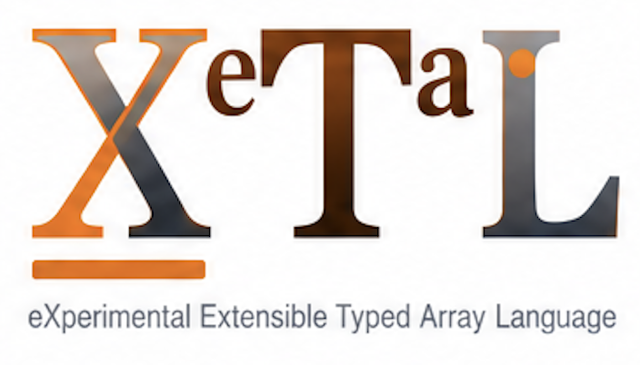

<h1>
  
  
</h1>

Interactive experiments in model adaptation, fine-tuning and direct
weight editing, in [X_eTaL](https://github.com/softwarewrighter/X_eTaL),
the eXperimental Extensible Typed Array Language: lessons a beginner
can follow, with every number computed by a short array program you
can read.

## Summary

Fine-tuning changes what a trained model does by changing some of its
numbers. This repository teaches how, from the first idea (a weight, a
prediction, an error) to low-rank adapters (LoRA and its variations),
the alternatives to them (among them learning without
back-propagation), direct edits of a model's weights and an AI doing
the editing, and it measures the methods against each other on the
same small tasks.

It starts from the
[LoRA explorer](https://softwarewrighter.github.io/X_eTaL-ML/lora-explorer/)
of [X_eTaL-ML](https://github.com/softwarewrighter/X_eTaL-ML), which
shows the mathematics of one adapted layer. The explorer stays as it
is; here the same libraries are put behind a guided laboratory for
someone who knows arithmetic and has never trained a network.

Every lesson follows one arc:

> a question and your prediction -> one small experiment -> what
> changed, in plain words and measured numbers -> the mathematics and
> the X_eTaL code, as deep as you want to go.

What a lesson promises:

- **Three depths, one computation.** Beginner (guided, plain language),
  Explorer (every control) and Advanced (equations, gradients, source)
  show the same run; switching never resets it.
- **Everything is explained.** Each symbol and control has a
  definition, a short explanation, a worked example and a lesson, by
  mouse, keyboard or touch.
- **Step through it.** The forward pass and a training step play,
  pause and step both ways; any cell shows its own arithmetic with its
  numbers.
- **Changes are explained, not just redrawn.** Move the rank and the
  page says what that did, from what it measured, including when it
  did not help: on an 8 x 8 layer, rank 4 trains as many numbers as
  full fine-tuning.
- **Every number is real.** The values, shapes and loss figures on a
  page come from the X_eTaL program it shows; nothing is recomputed in
  the browser's own code.

## Why an array language for fine-tuning

A LoRA layer is `y = W x + s B (A x)`: two matrix products, a scale
and a sum. Its gradients are two outer products. A rank-one model edit
is one outer product and one solve. In X_eTaL each is one short, typed
expression over whole arrays, so a lesson can show the method itself,
with every intermediate array and its shape, instead of a framework
call:

```
lo:f_orward := { (W, A, B, s) x -> (W '+ '* i_nner x) + s * B '+ '* i_nner A '+ '* i_nner x }
```

Read right to left: `A x` first (r numbers), then `B` of that, scaled,
added to the frozen layer's output. The 8 x 8 matrix `B A` is never
made.

## The X_eTaL repositories

| Repo | What it is |
| ---- | ---------- |
| [X_eTaL](https://github.com/softwarewrighter/X_eTaL) | the language, interpreter, REPL, editor, notebook and browser playground |
| [X_eTaL-demos](https://github.com/softwarewrighter/X_eTaL-demos) | visual array and scientific computing demos |
| [X_eTaL-ML](https://github.com/softwarewrighter/X_eTaL-ML) | machine-learning demos and libraries |
| **X_eTaL-fine-tuning** (this repo) | lessons and experiments in fine-tuning, adapters and weight editing |
| [X_eTaL-games](https://github.com/softwarewrighter/X_eTaL-games) | interactive games and puzzles |
| [X_eTaL-libraries](https://github.com/softwarewrighter/X_eTaL-libraries) | reusable function and macro libraries |
| [X_eTaL-extensions](https://github.com/softwarewrighter/X_eTaL-extensions) | native Rust extensions and the extension ABI |
| [X_eTaL-gpu](https://github.com/softwarewrighter/X_eTaL-gpu) | X_eTaL programs on GPUs, old ones included (OpenCL) |
| [X_eTaL-fpga](https://github.com/hardwarewrighter/X_eTaL-fpga) | X_eTaL programs as hardware (FPGA circuits) |

## The road

Three stages, in this order ([`docs/plan.md`](docs/plan.md)):

| Stage | Methods | The question |
| ----- | ------- | ------------ |
| 1. LoRA | a frozen layer and a low-rank adapter, its training, rank and scale, LoRA-FA | how can a model learn something new while its weights stay as they are? |
| 1. LoRA variations | QLoRA, DoRA, VeRA and others; adapters in a mixture of experts | what does each variation change, and what does it buy or cost? |
| 2. Alternatives | weight-space methods that use no back-propagation (zeroth-order optimization and evolution strategies: MeZO, DART-ES, AGZO, StructZO, Dust), beside back-propagation itself; then the other alternatives briefly | can a model learn from forward passes alone, at what cost, and when is that the better choice? |
| 3. Bleeding edge | closed-form edits of a layer (ROME, MEMIT, AlphaEdit), an AI editing a model's weights directly | can a model be changed without training at all, and can a model do that to a model? |
| Later: applied | a coding model taught a team's engineering standards, measured by an executable grader, on real open-weight models | does any of this make a real model better at a real job, and how is that proved? |

Every method is held to the same account: what was learned, what was
lost, and what it cost, on the same task, beside a baseline that
changes no weight.

## Demos

Live: [the catalog](https://softwarewrighter.github.io/X_eTaL-fine-tuning/).

| Demo | What you see | The line that does it |
| ---- | ------------ | --------------------- |
| [LoRA hello](demos/lora-hello/README.md) ([live](https://softwarewrighter.github.io/X_eTaL-fine-tuning/lora-hello/)) | start here, with no machine learning and no programming assumed: how do you teach a model something new without it forgetting, and without retraining all of it? The question and the background, every term opening a plain explanation; one frozen layer of 16 numbers and an adapter of 8, all shown; one calculation worked in five steps as you change the input or the strength; the cost on a real layer (0.78% of its numbers at rank 16); what that showed and what it did not. The code is folded into asides, each library function explained from its own source and linked to the cross-reference | `y := (W, A, B, s) lo:f_orward x`: the layer and its adapter are one bundle, taken apart by the library |


The lessons to come, in order ([`docs/plan.md`](docs/plan.md)):

| Lesson | What you will do |
| ------ | ---------------- |
| LoRA lab | the five-minute journey, "how does a tiny adapter change a frozen layer?": step through `y = W x + s B (A x)` on an 8 x 8 layer, open any cell's arithmetic, select a symbol of the equation to see its matrix and its code, move the rank |
| LoRA training | one training step narrated in six stages, then training on examples with a held-out set; presets for a learning rate too large and for overfitting |
| Rank and scaling | rank and alpha swept, the measured cost and effect explained; alpha / r beside rsLoRA's alpha / sqrt r |
| LoRA against LoRA-FA | both fitting a known matrix against the best any rank-r update can do (the truncated SVD), and why a frozen A limits what B can learn |
| The map | where LoRA sits among the ways to change a model, each set against forgetting, time and cost, and what the later lessons compare |

Then a map of where LoRA sits; the variations (QLoRA, DoRA, VeRA);
the alternatives; and the bleeding edge.

## Libraries

This repository has none of its own: a lesson's program composes
functions of X_eTaL-ML's libraries (LoRA, Optim, Flow, NN, Quant) and
X_eTaL-libraries' (Equations, Plot, Matrix, Check), at pinned commits,
and X_eTaL's built-in words. A function a lesson needs and those
libraries lack is asked for where it belongs, not written here:

| Asked of | In | For |
| -------- | -- | --- |
| X_eTaL-ML | [`docs/xetal-ML-asks.md`](docs/xetal-ML-asks.md) | machine learning: the learning task and its measures, the LoRA variations, learning without back-propagation, closed-form editing |
| X_eTaL-libraries | [`docs/xetal-libraries-asks.md`](docs/xetal-libraries-asks.md) | general mathematics and notation |
| X_eTaL-extensions | [`docs/xetal-extensions-asks.md`](docs/xetal-extensions-asks.md) | native code, in preference to a change of the language |

Rust appears here only as the pages' presentation (the WebAssembly
host that runs X_eTaL in the browser and lays out what it prints):
every algorithm and every number shown is X_eTaL's.## Status

| | |
| - | - |
| Now | the build machinery (one pin, the gate, the live site) and a first demo, LoRA hello, at the command line and live, on X_eTaL-ML's LoRA library. No lesson and no library of this repository yet |
| Next | the shared teaching shell (glossary and tooltips, stepper, heat maps, the narrator of changes), then the LoRA lab |
| Asks | this repository defines no functions of its own; what the lessons need from the others is asked for: [`docs/xetal-ML-asks.md`](docs/xetal-ML-asks.md), [`docs/xetal-libraries-asks.md`](docs/xetal-libraries-asks.md), [`docs/xetal-extensions-asks.md`](docs/xetal-extensions-asks.md). No step of the present saga is blocked; the LoRA variations wait on X_eTaL-ML. Nothing is asked of the language |

## Build

Requirements: Rust (stable, with the `wasm32-unknown-unknown` target
and [`trunk`](https://trunkrs.dev/) for the pages), git,
[`just`](https://github.com/casey/just),
[`uv`](https://docs.astral.sh/uv/), and for the tests
`reg-rs`, `sw-markdown-checker` and Google Chrome (the pages are
checked headless). The scripts' Python is a uv-managed virtual
environment, `.venv` (Python 3.12, from `.python-version`), made by
`scripts/py` on first use; the system's Python is never used. The
first `just xetal` needs the network.

```bash
just                   # list the recipes
just xetal             # fetch X_eTaL-ML at the pinned commit, and build the X_eTaL it pins (bin/xetal)
just xetal-version     # the commits pinned, and the binary's own report
just eval "'+ r_/ 1 2 3"
just demos             # the demos, in catalog order
just run lora-hello    # run a demo's program at the command line; just show for a notebook
just serve lora-hello  # its page at http://127.0.0.1:8212/
just test              # every demo and library baseline
just gate              # the pre-commit gate: what the change touches; just gate --full for everything
```

This repository tracks no copy of X_eTaL or of X_eTaL-ML:
`XETAL_ML_COMMIT` holds the X_eTaL-ML commit it is known to work
with, and `just xetal` clones that into the gitignored
`work/xetal-ml/`, where X_eTaL-ML's own script fetches and builds the
X_eTaL and X_eTaL-libraries commits it was tested with. Every recipe
runs that binary, so results do not depend on whatever `xetal` is on
your PATH. `just ml-pin [REF]` moves to a newer X_eTaL-ML.

The libraries are found on one search path: this repository's, then
X_eTaL-ML's, then X_eTaL-libraries'.

```bash
export XETAL_PATH="$(just path)"    # use them from your own programs
just pages                # build the live site into pages/ (not tracked): the catalog, each page, the cross-reference in pages/doc
just publish              # put it live: pages/ becomes the gh-pages branch
just check-live           # the deployed pages run X_eTaL and report this commit
just serve-pages          # preview it at http://127.0.0.1:8212/X_eTaL-fine-tuning/
just new-demo SLUG "Title"              # start a demo from demos/_template
just new-lib Name alias: "what it is"   # start a library from templates/Library
```
### Layout

- `demos/<slug>/` -- one lesson or experiment per directory: its
  `.xtl` programs, a README, reg-rs baselines in `reg/`, named
  experiments in `presets/`, and its web page in `web/`.
- `scripts/` -- the logic behind the `just` recipes, adapted from
  X_eTaL-ML's.
- `shared/lesson/` -- what every page shares, on X_eTaL-ML's page
  shell (presentation only): the frames of a page, words that open a
  plain explanation (the glossary), asides, a library function
  explained from its own source, code with every function linked to
  the cross-reference, the footer; the stepper, the heat maps and the
  narrator of changes next.
- `docs/` -- the plan, the research it came from, and the asks.

## Documentation

- [`docs/plan.md`](docs/plan.md) -- principles, decisions, the
  curriculum and the roadmap
- [`docs/new-eyes.md`](docs/new-eyes.md) -- how a page is written and
  checked for a reader who knows neither machine learning nor X_eTaL
- [`docs/research.txt`](docs/research.txt),
  [`docs/research2.txt`](docs/research2.txt),
  [`docs/research3.txt`](docs/research3.txt) -- the design review this
  repository came from, the wider discussion of fine-tuning, and a
  review of weight-space fine-tuning without back-propagation
  (archival)
- [`docs/xetal-ML-asks.md`](docs/xetal-ML-asks.md),
  [`docs/xetal-libraries-asks.md`](docs/xetal-libraries-asks.md),
  [`docs/xetal-extensions-asks.md`](docs/xetal-extensions-asks.md) --
  what is asked of the sibling repositories
- [`CHANGES.md`](CHANGES.md) -- every commit

## Development

Development is tracked with agentrail sagas, as in X_eTaL:
`agentrail status` shows the current step, `agentrail next` its
instructions. Every step ends with the gate passing, docs updated, a
commit to `main` and a push. Every commit is listed in
[`CHANGES.md`](CHANGES.md). The rules agents follow are in
[`CLAUDE.md`](CLAUDE.md) (`AGENTS.md` is the same file).

## Related Projects

- [X_eTaL-ML's LoRA explorer](https://softwarewrighter.github.io/X_eTaL-ML/lora-explorer/)
  -- the mathematics of one adapted layer, where this repository
  starts.
- [sw-mlpl](https://github.com/sw-ml-study/sw-mlpl) -- Software
  Wrighter's Machine Learning Programming Language, a Rust array
  language inspired by APL, APL2, J, and BQN.

## Links

- Blog: [Software Wrighter Lab](https://software-wrighter-lab.github.io/)
- Discord: [Join the community](https://discord.com/invite/Ctzk5uHggZ)
- YouTube: [Software Wrighter](https://www.youtube.com/@SoftwareWrighter)

## Copyright

Copyright (c) 2026 Michael A Wright

## License

MIT. See [`LICENSE`](LICENSE) and [`COPYRIGHT`](COPYRIGHT).
